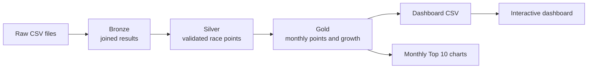

# F1 Constructor Performance Tracker

An end-to-end analytics project that turns raw Formula 1 results into a clean monthly dataset and an
interactive dashboard of constructor performance from 1958 to 2025.

**[Open the live dashboard](https://nolimitbaiza.github.io/f1_constructor_performance_tracker/)**


## At a glance

| Measure | Value |
|---|---:|
| Constructor race results | 12,775 |
| Races | 1,075 |
| Constructors | 175 |
| Seasons | 68 (1958 through August 2025) |
| Monthly analytics rows | 6,708 |

## What the data shows

Scoring rules have changed many times, so these comparisons use each team's **share of all points
scored in the period** rather than raw point totals.

| Period | Leader | Share of points | Next best |
|---|---|---:|---|
| 2000–2004 | Ferrari | 37.3% | McLaren, 20.4% |
| 2010–2013 | Red Bull | 28.3% | Ferrari, 19.6% |
| 2014–2021 | Mercedes | 33.3% | Red Bull, 19.5% |
| 2023 | Red Bull | 35.0% | Mercedes, 16.6% |

Mercedes also finished first in the constructors' standings in all eight seasons from 2014 to 2021.

## How it works



| Stage | Module | What it does |
|---|---|---|
| Bronze | `ingest.py`, `add_month.py` | Joins results, races and constructors with Pandas, then adds a month column |
| Silver | `clean.py` | Checks columns and dates, removes duplicate race-team records, handles invalid points and reports missing values |
| Gold | `aggregate.py` | Uses DuckDB SQL with CTEs and `LAG` to calculate monthly points and month-over-month growth |
| Publish | `export.py` | Writes the CSV file used by the dashboard |
| Charts | `report.py`, `render_charts.py` | Creates Top 10 constructor charts with Matplotlib |

## Dashboard features

- Filter by season, month and team.
- Switch between ranked bar charts and cumulative points lines.
- Compare two to four views side by side.
- Total points over any custom date range.
- Download tables as CSV and charts as PNG.

## Run it locally

```bash
pip install -r requirements.txt

# Rebuild every data layer and the dashboard CSV
python -m src.tracker.pipeline

# Optional: create one chart, or a chart for every month
python -m src.tracker.report --month 2021-12
python -m src.tracker.render_charts

# View the dashboard at http://localhost:8000
python -m http.server 8000 --directory docs
```

## Project structure

```text
data/raw/         Source CSV tables
data/bronze/      Joined race results
data/silver/      Validated race-level points
data/gold/        Monthly constructor table
src/tracker/      Pipeline stages and chart generation
docs/             Dashboard published with GitHub Pages
reports/charts/   Generated monthly Top 10 charts
scripts/          Optional FastF1 to PostgreSQL loader
```

## Tech stack

Python, Pandas, DuckDB, SQL, Parquet, Matplotlib, JavaScript, Chart.js, Bootstrap, PapaParse and
GitHub Pages.

## Notes and limitations

- The analysis starts in 1958, the first year of the constructors' championship.
- The 2025 season is partial: the data ends in August 2025.
- Points are grouped by the calendar month of each race.
- Raw point totals are not directly comparable across eras because scoring systems changed.
- `scripts/load_fastf1_to_postgres.py` is an optional, separate loader. It needs
  `requirements-fastf1.txt`, a PostgreSQL database and a `.env` file based on `.env.example`.

## License

[MIT](LICENSE)
